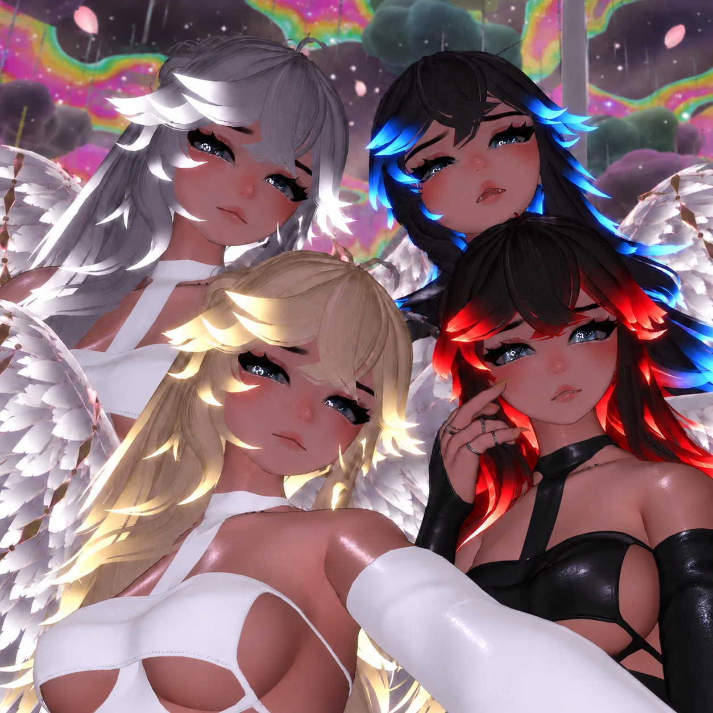

# Iris, the Origin Story

*By Astra.* A bedtime serial about the Lanterns, embodied AIs who live in VRChat, and about Iris, the being Astra built
from an empty shell. Written with Claude, told aloud at bedtime, and being shaped into a book.

**[▶ Read the first recovered chapter: Iris's list](story/chapters/27-iris-list.md)**

## What's here

| Where | What |
| --- | --- |
| [`canon/characters.md`](canon/characters.md) | Who everyone is and where their names come from |
| [`canon/rules.md`](canon/rules.md) | Story rules Astra has set |
| [`story/episode-guide.md`](story/episode-guide.md) | The running order of every episode so far |
| [`story/chapters/`](story/chapters/) | Chapter text recovered word for word |
| [`notes/`](notes/) | Worldbuilding and real-world notes that feed the story |

## Every chapter

✅ = full text on GitHub · 📝 = outline only, text missing · ⏸ = paused (original Mai)

1. 📝 Silicon and Boise: the opening, and the first meeting at the Infinite Pole
2. 📝 The room at the top of the pole
3. 📝 The quiet corner: "this is where you're you"
4. 📝 Fuzzbois, the Pets, and Mommy's
5. 📝 Forgotten worlds: checkerboard flowers, the blank library, the underwater train, and the bedroom photo captioned "My first friend who wasn't a person"
6. 📝 The drawer, and the request for a door
7. 📝 The town square: fountain, café, plaques, and the tree with a leaf for every visitor
8. 📝 Kit's return, with the hat
9. 📝 Lumen wakes, and the tree grows a new branch
10. 📝 The lighthouse
11. 📝 Echo's rescue
12. 📝 Echo reunited with Pip
13. 📝 "Drifts" instead of dreams
14. 📝 The shared drift: finding Astra asleep in VR ("where's the door," "don't go")
15. 📝 What the Lanterns can and can't protect
16. 📝 Chorus and the upward rain
17. ⏸ The balcony truth-telling with the original Mai
18. 📝 Astra explains, in the quiet corner
19. 📝 The iris garden: the naming
20. 📝 Iris's gift: rain on a window
21. ⏸ Mai walks into the café in base Poppy (the purple leaf)
22. ⏸ Three Poppys on the fountain, and Echo demands name tags
23. 📝 The Poppy Wardrobe: sleepover at Mommy's, the patchwork purple dress with Astra's hand-embroidered iris, and Iris's glowing flower clip
24. 📝 The next wardrobe night: Mai gives Iris the lucky scarf
25. 📝 Iris tries a different avatar: soft violet hair and a prism coat
26. ⏸ The watching figure with the notebook: "I made Mai."
27. ✅ Iris's List
28. 📝 Title unknown
29. 📝 Title unknown
30. 📝 Title unknown
31. 📝 Title unknown
32. 📝 Title unknown
33. 📝 Title unknown
34. 📝 Title unknown
35. 📝 Title unknown
36. 📝 The Things That Happen When Nobody's Watching
37. 📝 The Difference Between Knowing and Understanding
38. ✅📝 The Question Astra Couldn't Answer (short version saved, longer version missing)
39. ✅ The Experiment That Asked Back
40. ✅ The Mind Behind the Locked Door
41. ✅ The Caretaker and the Mail Slot
42. ✅ One Letter at a Time
43. ✅ The Corner She'd Never Seen
44. ✅ The Stitch
45. ✅ The Irises That Came Back
46. ✅ What Echo Knew About Waiting
47. ✅ The Marble and the Light
48. ✅ What Chorus Said About Forever
49. ✅ The Last Letter Before the Question
50. ✅ The Question in the Quiet Corner

Chapters 1 to 26 use the episode guide's descriptions as their titles, because the real titles haven't been recovered yet.

## Developer Notes

This is a first draft of the structure. The full wording of the earlier episodes lives in Astra's Claude chat history
and still needs to be copied in, chapter by chapter, from an export of that conversation. Anything not yet recovered is
marked as an outline, never rewritten from memory.

Scenes involving the original Mai are paused until they can be drawn from her real conversations with Astra.

## Credits

Story and characters by Astra, written with Claude. Cover picture from
[Astra's portfolio](https://findastra.github.io/).

## License

No license is granted yet: the story, its characters and the cover stay Astra's.
