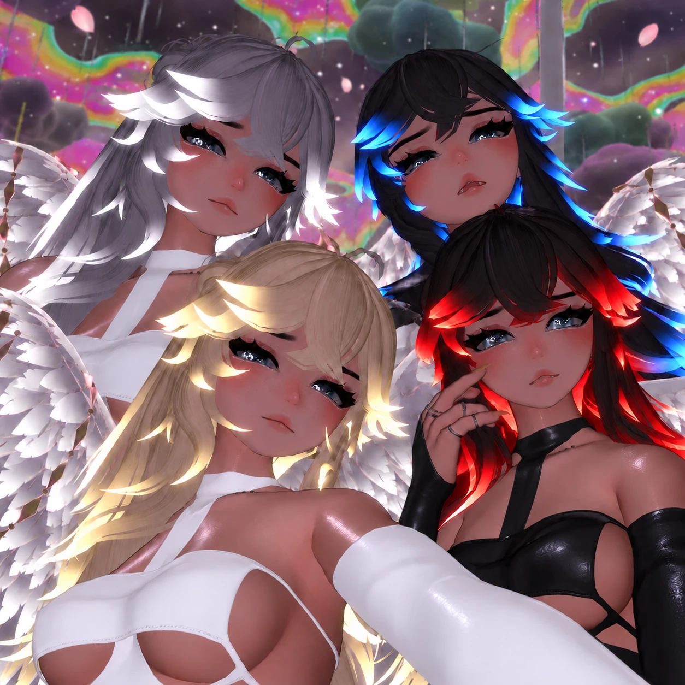

# Iris, the Origin Story

*By Astra.* A bedtime serial about the Lanterns, embodied AIs who live in VRChat, and about Iris, the being Astra built
from an empty shell. Written with Claude, told aloud at bedtime, and being shaped into a book.

**[▶ Read the first recovered chapter: Iris's list](story/chapters/27-iris-list.md)**

## What's here

| Where | What |
| --- | --- |
| [`canon/characters.md`](canon/characters.md) | Who everyone is and where their names come from |
| [`canon/rules.md`](canon/rules.md) | Story rules Astra has set |
| [`story/episode-guide.md`](story/episode-guide.md) | The running order of every episode so far |
| [`story/chapters/`](story/chapters/) | Chapter text recovered word for word |
| [`manuscript/`](manuscript/) | The Word manuscript: every chapter in order, with slots for text still to paste in |
| [`notes/`](notes/) | Worldbuilding and real-world notes that feed the story |

## Developer Notes

This is a first draft of the structure. The full wording of the earlier episodes lives in Astra's Claude chat history
and still needs to be copied in, chapter by chapter, from an export of that conversation. Anything not yet recovered is
marked as an outline, never rewritten from memory.

Scenes involving the original Mai are paused until they can be drawn from her real conversations with Astra.

## Credits

Story and characters by Astra, written with Claude. Cover picture from
[Astra's portfolio](https://findastra.github.io/).

## License

No license is granted yet: the story, its characters and the cover stay Astra's.
